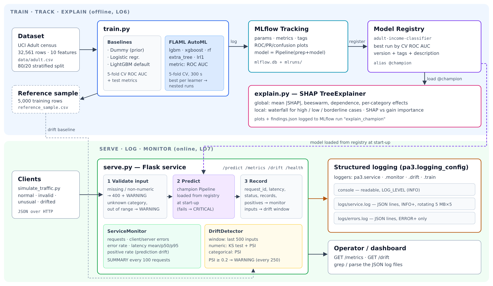

# DAM405 Programming Assignment 3 – From AutoML to a Monitored, Explainable Model

An end-to-end workflow on the **UCI Adult Census Income** dataset (predict whether income > $50K):

1. **Train & track** – three baselines and a **FLAML** AutoML search, every run tracked in **MLflow**
   (parameters, metrics, plots, models); the best model is registered as `adult-income-classifier@champion`.
2. **Explain** – **SHAP** global and local explanations of the registered model, logged to MLflow.
3. **Serve, log & monitor** – a **Flask** service that loads the model from the registry, with structured
   JSON logging, request/latency/error-rate monitoring and **KS + PSI data-drift detection**.



## Setup

```bash
python -m venv .venv && source .venv/bin/activate   # Windows: .venv\Scripts\activate
pip install -r requirements.txt
```

Python 3.10+ (tested on 3.13). `data/adult.csv` is included; `python prepare_data.py` re-downloads it.

## Run

```bash
python train.py            # baselines + FLAML (300 s budget), MLflow tracking, registry
python explain.py          # SHAP plots -> artifacts/shap/ and MLflow run "explain_champion"
python serve.py            # terminal A: service on http://127.0.0.1:8000
python simulate_traffic.py # terminal B: normal, invalid, unusual and drifted traffic
python -m pytest -v tests/ # automated checks
mlflow ui                  # browse runs and the registry at http://localhost:5000
```

`bash run_all.sh` runs train → explain → serve → traffic → tests in one go (Linux/macOS/Git Bash).
For a quicker run set `AUTOML_TIME_BUDGET=60`. Set `LOG_LEVEL=DEBUG` to log raw request payloads.

### Example request

```bash
curl -X POST localhost:8000/predict -H "Content-Type: application/json" -d '{"records": [{
  "age": 45, "workclass": "Private", "education_num": 13, "marital_status": "Married-civ-spouse",
  "occupation": "Exec-managerial", "relationship": "Husband", "capital_gain": 0,
  "capital_loss": 0, "hours_per_week": 50, "native_country": "United-States"}]}'
```

## Repository structure

| Path | Purpose |
|---|---|
| `pa3/config.py` | Features, paths, MLflow names, AutoML settings |
| `pa3/data.py` | Loading, stratified split, preprocessing (kept inside the model pipeline) |
| `pa3/logging_config.py` | Console + rotating JSON file + error-file handlers, timestamps, levels |
| `pa3/monitoring.py` | Request count, client/server errors, error rate, latency p50/p95, positive rate |
| `pa3/drift.py` | KS test + Population Stability Index drift detector over a sliding window |
| `prepare_data.py` | Downloads the Adult dataset to `data/adult.csv` |
| `train.py` | Baselines + FLAML AutoML, MLflow tracking, model registry, fairness check |
| `explain.py` | SHAP explanations of the champion model |
| `serve.py` | Flask service: `/predict`, `/metrics`, `/drift`, `/health` |
| `simulate_traffic.py` | Traffic generator used for the evidence in the report |
| `tests/test_pa3.py` | 10 pytest checks covering tracking, registry, logging, drift and the service |
| `artifacts/` | Generated plots, comparison tables, SHAP findings, traffic report |
| `logs/` | `training.log`, `service.log` (JSON lines), `errors.log` |
| `mlflow.db`, `mlruns/` | MLflow tracking store and model registry |
| `evidence/` | MLflow UI screenshots, console output and log samples used in the report |
| `docs/architecture.png` | Architecture / workflow diagram |

## Design notes

- **Model selection uses 5-fold CV ROC AUC on the training set only**; the test set is used once, for reporting.
- **`sex` and `race` are not model inputs.** They are kept in the data only for a fairness check
  (`artifacts/fairness_check.csv`).
- Preprocessing is part of the registered sklearn `Pipeline`, so the service sends raw records.
- MLflow 3 saves sklearn models with skops; the LightGBM/XGBoost/tree types we trust are listed in `train.py`.

## Data and libraries

- Becker, B. & Kohavi, R. (1996). *Adult* [Dataset]. UCI Machine Learning Repository. https://doi.org/10.24432/C5XW20 (CC BY 4.0)
- FLAML (Wang et al., 2021), MLflow, SHAP (Lundberg & Lee, 2017), LightGBM, XGBoost, scikit-learn, Flask, SciPy.

## AI use

Developed with assistance from an AI tool (Claude, Anthropic); see the declaration in the report.
# AS2025_DAM405_02230289_pa3
